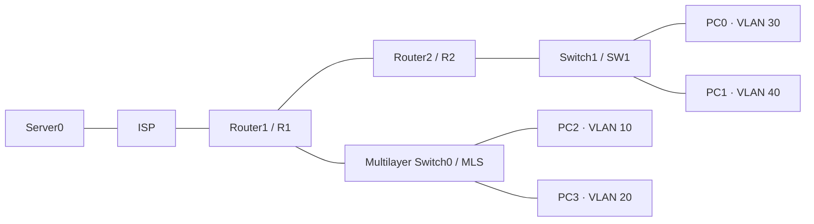

# UNLaM — Networking Labs

Selected **2024 team coursework with Federico Pucci** from Redes de Computadoras at Universidad Nacional de La Matanza: IPv4/IPv6 addressing, Wireshark analysis and Packet Tracer routing experiments.

| Topic | Published material | Verification scope |
| --- | --- | --- |
| [Address planning](docs/addressing.md) | Five IPv4 subnets and three reviewed IPv6 point-to-point examples | Address arithmetic, non-overlap, gateways and growth capacity |
| [Packet analysis](docs/packet-analysis.md) | Reviewed ICMP, DNS and TCP display-filter notes | Report-based analysis; no raw capture is redistributed |
| [Routing and VLANs](docs/routing.md) | Historical `.pkt`, five extracted configs, three report screenshots and five reviewed OSPF overlays | Native-file integrity and static plan consistency; simulator execution remains manual |

The author is listed in the original reports alongside the other team members. [SOURCES.md](SOURCES.md) records the team attribution. Individual task allocation is not documented, so this collection does not claim that Federico independently authored every configuration or report section.

## Routing topology

The saved file contains **11 objects: 10 network devices and one power-distribution object**, connected by nine data cables. The diagram shows the physical network and the VLAN assignment proposed by the reviewed overlays.



## What is historical and what is reviewed

- [Historical Packet Tracer file](labs/routing/archive/topology.pkt): retained from the TP2 directory, byte-for-byte unchanged; saved by Packet Tracer `8.2.2.0400`.
- [Extracted configurations](labs/routing/archive/configs): the saved intermediate state. It has no completed routing-protocol configuration and contains an incompatible serial-link address. It is not the same state as all the report screenshots.
- [Reviewed overlays](labs/routing/reviewed): publication-time IPv4 OSPF configuration steps for that base topology. They correct addressing, define VLAN access ports, propagate a default route and add ISP return routes. Apply them manually using the [routing guide](docs/routing.md); no modified working `.pkt` is claimed.

The archive retains Packet Tracer's factory/demo settings, including demonstration account/password fields. It is an isolated educational snapshot, not a production configuration. The reviewed text overlays contain no account credentials.

## Run the static checks

Python 3.10+ is sufficient for address and reviewed-plan checks:

```sh
python scripts/verify.py
```

For native-file decode/encode integrity checks as well:

```sh
python -m pip install -r requirements-native.txt
python scripts/verify.py --native
```

The optional decoder is the external [packet-tracer-pkt-format](https://github.com/aacanadaa/packet-tracer-pkt-format) tool, pinned to `0.4.1`. It is not authored by this team. The checks compare the native inventory and cable endpoints, validate its SHA-256 and verify an exact decode/encode round trip. CI repeats these checks.

**Static checks do not execute Cisco IOS or Packet Tracer.** Neighbor formation, convergence, host connectivity and the reviewed command sequence still need the manual simulator procedure. Historical report screenshots demonstrate retained experiment states; they are not new successful runs of the publication overlays.

See [review notes](docs/review-notes.md) for corrections and limits. Course handouts, unrelated student submissions and live traffic captures were left out. Original local files remain unchanged.

[Main portfolio](https://github.com/FedePucci1/portfolio-index)
