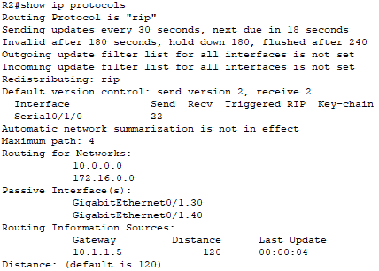
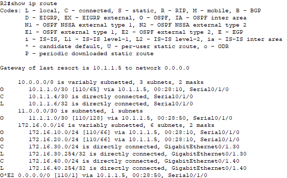
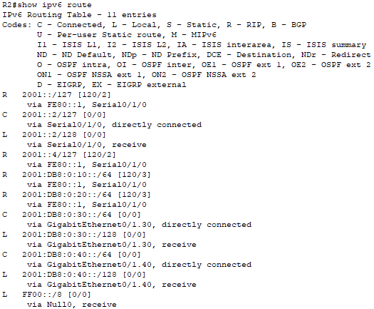

# Routing and VLAN lab

This guide connects the retained 2024 team report with the saved base topology and a reviewed IPv4 OSPF experiment. **The reviewed overlays have been checked statically; they have not been executed in Packet Tracer during publication.**

## Files and device names

| Saved device label | Reviewed hostname | Role |
| --- | --- | --- |
| ISP | ISP | Simulated upstream router and return routes |
| Router1 | R1 | Internal transit, static default and default advertisement |
| Router2 | R2 | Router-on-a-stick for VLANs 30 and 40 |
| Multilayer Switch0 | MLS | Routed uplink and SVIs for VLANs 10 and 20 |
| Switch1 | SW1 | Layer-2 access switch and trunk to R2 |

- [Historical `.pkt`](../labs/routing/archive/topology.pkt), written by Packet Tracer `8.2.2.0400`.
- [Extracted saved configs](../labs/routing/archive/configs), retaining the incomplete historical state.
- [Reviewed configuration overlays](../labs/routing/reviewed) and [machine-readable plan](../labs/routing/reviewed/plan.json).

The power-distribution object has no data cable and is counted separately from the ten network devices. The server, four PCs, two routers, two switches and ISP router account for the ten network devices.

## Planned IPv4 addressing

| Link | Endpoint A | Endpoint B |
| --- | --- | --- |
| R1–MLS | R1 G0/0: `10.1.1.2/30` | MLS G1/0/24: `10.1.1.1/30` |
| R1–R2 | R1 S0/0/0: `10.1.1.5/30` | R2 S0/1/0: `10.1.1.6/30` |
| R1–ISP | R1 S0/0/1: `203.0.113.2/30` | ISP S0/0/1: `203.0.113.1/30` |

| Host | Address | Gateway | Access port |
| --- | --- | --- | --- |
| PC0 | `172.16.30.10/24` | `172.16.30.254` | SW1 F0/1, VLAN 30 |
| PC1 | `172.16.40.10/24` | `172.16.40.254` | SW1 F0/2, VLAN 40 |
| PC2 | `172.16.10.10/24` | `172.16.10.254` | MLS G1/0/1, VLAN 10 |
| PC3 | `172.16.20.10/24` | `172.16.20.254` | MLS G1/0/2, VLAN 20 |
| Server0 | `198.51.100.2/27` | `198.51.100.1` | ISP G0/0 |

The two documentation ranges represent an isolated simulated ISP/server segment, not a connection to the public Internet. The archival snapshot still has its original addresses; applying the overlays and setting the hosts is a separate step.

## Manual simulator procedure

1. Open a local copy of the archived `.pkt` in Cisco Packet Tracer. Save the working copy separately, for example under the ignored `build/` directory.
2. Keep the existing cabling and modules. Confirm serial DCE clocking and interface status; the text overlays assume the physical base lab is retained.
3. Apply the corresponding `.cfg` files to ISP, Router1, Router2, Multilayer Switch0 and Switch1. These are CLI overlays for this base file, not complete factory-reset startup configurations. They begin with `enable` / `configure terminal` and finish with `end`.
4. Set the five end-host IPv4 addresses, masks and gateways from the table above in Desktop → IP Configuration. In particular, PC1 and PC3 move to the second VLAN on their respective switches.
5. Verify the physical and VLAN interfaces before expecting routing adjacency:

   ```text
   show ip interface brief
   show interfaces trunk
   show vlan brief
   ```

6. Verify the planned OSPF area 0 experiment:

   ```text
   show ip ospf neighbor
   show ip protocols
   show ip route
   show running-config | section router ospf
   ```

   Expected from the design: R1 has R2 and MLS as internal neighbors; R2 and MLS each have R1. LAN interfaces are passive. R1 originates a default only when its static default is present. R2 and MLS should learn a default, while ISP uses static return routes for the lab LANs and internal transit summary. These are expectations to check, not recorded new simulator results.

7. From each PC, check its own gateway, a host in another VLAN and Server0. Check reverse reachability from Server0. Inspect routes and source addresses if a test fails; do not infer end-to-end reachability from a green cable alone.
8. Record the observed neighbor states, route tables, ping source/destination pairs and results. Save the resulting working copy only after that manual verification. This repository does not include such a newly verified save.

The overlays address IPv4. Existing IPv6 configuration in the archived file is not repaired or validated by this procedure.

## Retained report evidence

These screenshots are copied unchanged from the 2024 team report. They represent different experiment states and are not outputs of a new run of the overlays above.

### RIPv2 protocol inspection on R2



The output shows RIPv2, disabled automatic summarization, passive LAN interfaces and administrative distance 120. It is protocol inspection, not proof of every end-to-end flow.

### OSPF routes on R2



The table includes OSPF routes with administrative distance 110 and an external default. The retained report text incorrectly assigns OSPF distance 120; the publication corrects that distinction using [Cisco's administrative-distance reference](https://www.cisco.com/c/en/us/support/docs/ip/border-gateway-protocol-bgp/15986-admin-distance.html).

### RIPng route inspection



This is retained IPv6 experiment evidence. It does not establish current IPv6 connectivity in the archived snapshot or the reviewed IPv4 plan. No EIGRP implementation is claimed from the unrelated other-group materials.
